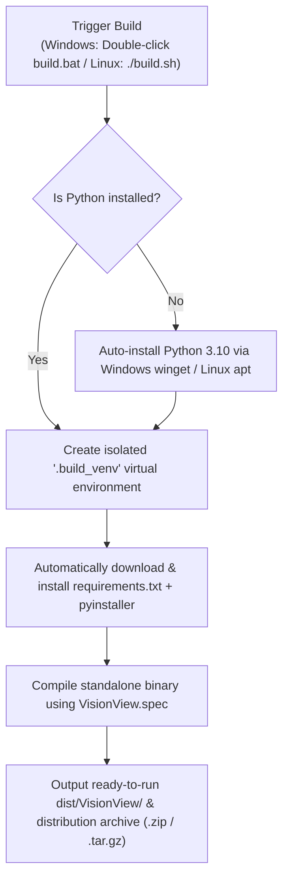

# VisionView

**VisionView** is a modular, high-performance Computer Vision and Industrial Camera inspection application built with **PySide6 (Qt for Python)**, **OpenCV**, and the **Basler Pylon Camera SDK**.

Get the latest release: [VisionView](https://github.com/irnow/visionview/releases/tag/v1.0.0)

---

## Key Features

- **Industrial Camera Support**: Native integration with Basler GigE and USB3 Vision cameras via `pypylon`, plus support for standard webcams and image workers.
- **Dual-Tab Camera Parameters**:
  - **Basic Tab**: Real-time control of Exposure Time, Gain, Contrast, Hue, Saturation, Brightness, and Reverse X/Y flipping.
  - **Advanced Tab**: Complete GenICam feature tree displaying over 200+ camera hardware nodes with live read/write capability.
- **Visual Process Editor (Node Canvas)**: Interactive node-graph pipeline allowing you to chain image processing blocks (Canny Edge Detection, CLAHE, Gaussian Blur, Thresholding, Crop, Resize, and Deep Learning).
- **Deep Learning / AI Inference**: Modular AI engine with built-in support for **RF-DETR** object detection and custom segmentation models.
- **Interactive Measurement Tools**: Pixel-accurate Area measurement tools (Square and Multi-point Polygon) with real-time area calculations.
- **High-Performance Video Pipeline**: Optimized multi-threaded frame processing with sub-2ms latency for high-resolution cameras (e.g., 4200×2128 at full framerate).
- **Instant Snapshots & Recording**: Keyboard shortcuts (`Ctrl+S` / `Ctrl+Shift+S`, case-insensitive) for instant image capture and AVI video recording stored automatically in a clean `media_output` directory alongside the application.
- **Modern Industrial UI**:
  - Pure white value fields for numerical SpinBoxes and ComboBoxes with responsive stepper buttons.
  - Solid blue indicator fills (`#0078d4`) for checkboxes without tick signs.
  - Consistent dock backgrounds across Saved Directory and Camera Parameters panels.
  - Smart canvas layout management: adding modules automatically restores enlarged modules to the grid to prevent window overlapping.

---

## Project Structure

```text
VISION_APP_FOR_GENERAL/
├── main.py                     # Main application window & UI lifecycle
├── test_audit.py               # Comprehensive 12-suite automated verification tests
├── requirements.txt            # Audited dependency specification (Core, Vision SDK & AI modules)
├── VisionView.spec             # PyInstaller packaging blueprint
├── build.py                    # Cross-platform Python build orchestrator
├── build.ps1                   # Automated Windows PowerShell build script (self-provisioning)
├── build.bat                   # Click-to-build Windows batch script (self-provisioning)
├── build.sh                    # Automated Linux & ARM build script (self-provisioning)
├── Dockerfile.build            # Multi-architecture container recipe (Linux x86_64 & ARM64)
├── build_docker.ps1 / .sh      # Docker cross-compilation helpers
├── .github/workflows/build.yml # GitHub Actions automated CI/CD matrix build
├── camera/                     # Camera SDK backends (Basler, workers, parameter dialogs)
├── computer_vision/            # Filter modules (Canny, CLAHE, blur, resize, crop, etc.)
├── ai_modules/                 # Deep learning inference scripts (RF-DETR)
├── utils/                      # Canvas node editor, annotations, video label, directory viewer
└── icons/                      # Toolbar icons and multi-resolution Windows app icon (.ico)
```

---

## Development Setup

### 1. Prerequisites
- Python 3.10 or 3.11
- Works with standard Python virtual environments (`venv`) or Anaconda/Miniconda

### 2. Installation
Clone the repository and install the dependencies:
```bash
git clone https://github.com/your-username/VisionView.git
cd VisionView

# Optional: create virtual environment
python -m venv venv
# Windows:
venv\Scripts\activate
# Linux/macOS:
source venv/bin/activate

# Install required packages
pip install --upgrade pip
pip install -r requirements.txt
```

### 3. Running in Development Mode
```bash
python main.py
```

### 4. Running the Test Suite
To verify that all GUI components, filter nodes, measurements, camera controls, and shortcuts work correctly:
```bash
python test_audit.py
```

---

## Automated Self-Provisioning Compilation

VisionView includes **fully automated, zero-configuration build scripts**. Anyone cloning or receiving this repository can build standalone executables without manually configuring Python or activating environments.

### How the Automated Build Flow Works



---

## Step-by-Step Compilation Guide by Platform

### Option 1: Windows (x64) Standalone Executable

#### Method A: Click-to-Build (Zero Terminal Knowledge Required)
1. Simply **double-click** [`build.bat`](file:///c:/Users/Hafizi/Documents/computer%20vision/VISION_APP_FOR_GENERAL/build.bat).
2. The script will automatically:
   - Detect any installed Python (or automatically install Python 3.10 via `winget` if missing).
   - Create an isolated `.build_venv` virtual environment in the project directory.
   - Automatically download and install all missing dependencies from `requirements.txt` and `pyinstaller`.
   - Compile the program using `VisionView.spec`.
   - Bundle Basler Pylon SDK binaries, OpenCV, and Qt Material Icons.
   - Produce a ready-to-run folder `dist\VisionView\` and a standalone zip `dist\VisionView-windows-x64.zip`.
   - **No pre-existing conda environment or manual command line activation required!**

#### Method B: PowerShell
```powershell
.\build.ps1
# To perform a clean rebuild:
.\build.ps1 -Clean
```

#### Method C: Cross-Platform Python CLI
```bash
python build.py --clean
```

---

### Option 2: Linux (Ubuntu / Debian x86_64)

To build a native Linux standalone application:

1. Copy or clone the project onto an Ubuntu / Debian machine.
2. Make `build.sh` executable and run it:
   ```bash
   chmod +x build.sh
   ./build.sh
   ```
3. **What `build.sh` does automatically**:
   - Ensures system Qt/OpenGL libraries (`libgl1`, `libegl1`, `libxkbcommon-x11-0`) are present.
   - Creates a `.build_venv` virtual environment.
   - Installs all dependencies from `requirements.txt`.
   - Compiles the application into `dist/VisionView/VisionView`.
   - Packages the distribution into `dist/VisionView-linux-x86_64.tar.gz`.

---

### Option 3: Linux ARM (Raspberry Pi 4/5 64-bit or NVIDIA Jetson)

VisionView runs natively on ARM single-board computers (Raspberry Pi 4/5 running 64-bit OS, NVIDIA Jetson Nano/Orin, RockPi).

1. On your ARM board, clone the repository.
2. Run the build script:
   ```bash
   chmod +x build.sh
   ./build.sh
   ```
3. The script automatically detects `aarch64` / `arm64` architecture, pulls ARM-compatible wheels, compiles the binary, and produces `dist/VisionView-linux-arm64.tar.gz`.

---

### Option 4: Cross-Compiling Linux & ARM from Any PC (Docker)

If you are on Windows or Mac and want to compile Linux x86_64 or Linux ARM64 binaries without physical Linux/ARM hardware, use Docker Buildx:

- **Windows PowerShell**:
  ```powershell
  # Compile for Linux ARM64:
  .\build_docker.ps1 -Platform linux/arm64

  # Compile for Linux x86_64:
  .\build_docker.ps1 -Platform linux/amd64

  # Compile both:
  .\build_docker.ps1 -All
  ```

- **Linux / macOS Bash**:
  ```bash
  chmod +x build_docker.sh
  ./build_docker.sh arm64    # Output in dist/docker-arm64/
  ./build_docker.sh x86_64   # Output in dist/docker-x86_64/
  ```

---

### Option 5: Automated Cloud Builds (GitHub Actions)

This repository includes a ready-to-use GitHub Actions workflow [`.github/workflows/build.yml`](file:///c:/Users/Hafizi/Documents/computer%20vision/VISION_APP_FOR_GENERAL/.github/workflows/build.yml).

- Whenever you push code or create a version tag (e.g., `git tag v1.0.0 && git push --tags`):
  1. GitHub cloud runners spin up **Windows**, **Ubuntu**, and **QEMU ARM64** virtual machines.
  2. All three platforms compile in parallel.
  3. Pre-packaged standalone ZIP and TAR.GZ archives are automatically uploaded to your GitHub repository's **Actions / Releases** tab for one-click downloading.

---

## Distributing to End Users

Once compiled, end users **do NOT need Python, Anaconda, or Git installed**:
1. Share the generated archive:
   - Windows: `VisionView-windows-x64.zip`
   - Linux: `VisionView-linux-x86_64.tar.gz`
   - ARM: `VisionView-linux-arm64.tar.gz`
2. The user extracts the archive and launches:
   - Windows: `VisionView.exe`
   - Linux / ARM: `./VisionView`

The application creates its output directory (`media_output`) alongside the program directory automatically.

---

## Adding Custom Filter Nodes & AI Models

- **Adding a Filter**: Place any new Python script in [`computer_vision/`](file:///c:/Users/Hafizi/Documents/computer%20vision/VISION_APP_FOR_GENERAL/computer_vision/) defining a `process(frame, params)` function and a `PARAMETERS` dictionary. VisionView will automatically discover it and add it to the Node Canvas.
- **Adding an AI Model**: Place your inference wrapper in [`ai_modules/`](file:///c:/Users/Hafizi/Documents/computer%20vision/VISION_APP_FOR_GENERAL/ai_modules/) defining a `MODEL(metadata_path, model_path)` class with a `predict(img, conf_thresh)` method.
